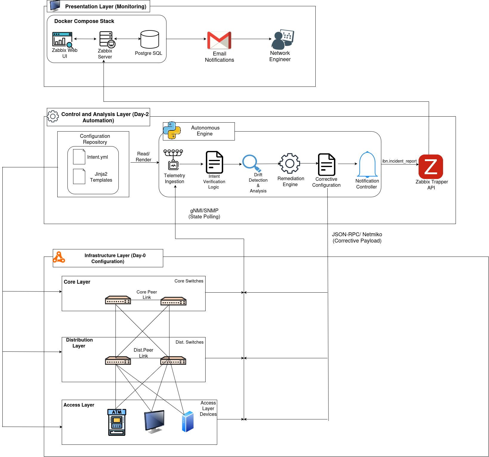
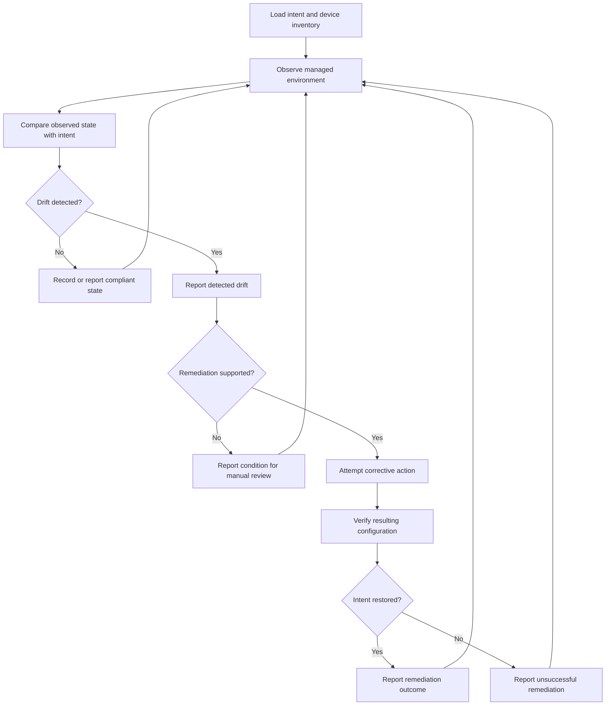
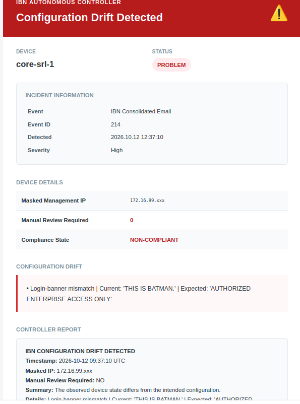
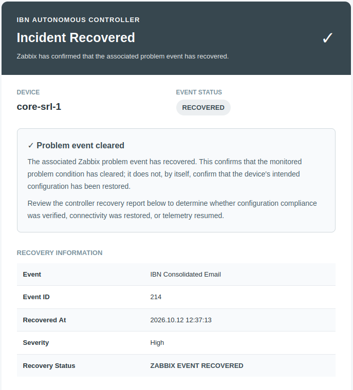

<div align="center">

# IBN Drift Controller

### Intent-Based Networking for Configuration Drift Detection and Automated Remediation

An autonomous controller for monitoring network infrastructure and Linux endpoints, detecting deviations from a defined operational intent and restoring supported configurations in a controlled Containerlab environment.


</div>

> **Project scope:** This repository contains an academic and laboratory prototype. Its banking-network context is simulated. It is not a production banking deployment and must not be connected to live financial infrastructure without substantial security, operational and engineering review.

---

## Table of Contents

- [Overview](#overview)
- [Objectives and Key Capabilities](#objectives-and-key-capabilities)
- [System Architecture](#system-architecture)
- [Laboratory Topology](#laboratory-topology)
- [Controller Workflow](#controller-workflow)
- [Technology Stack](#technology-stack)
- [Repository Structure](#repository-structure)
- [Prerequisites](#prerequisites)
- [Installation and Configuration](#installation-and-configuration)
- [Deploying the Lab](#deploying-the-lab)
- [Monitoring Interface](#monitoring-interface)
- [Demonstration and Validation](#demonstration-and-validation)
- [Screenshots](#screenshots)
- [Stopping the Lab](#stopping-the-lab)
- [Security Considerations](#security-considerations)
- [Limitations and Future Work](#limitations-and-future-work)
- [Author](#author)
- [License](#license)
- [Disclaimer](#disclaimer)

---

## Overview

Network environments contain multiple devices and endpoints whose configurations must remain consistent with operational and security requirements. Manual configuration reviews can be time-consuming and may allow unintended changes to remain undetected.

The **IBN Drift Controller** explores an Intent-Based Networking (IBN) approach to this problem. A declarative intent file describes the expected configuration of managed devices and endpoints. The controller uses this desired state as a reference when evaluating the observed environment and initiating corrective actions for supported drift conditions.

The project is demonstrated in a containerised enterprise-style laboratory built with Containerlab and Docker Compose. The environment includes Nokia SR Linux network devices, Alpine Linux endpoints, a Python controller and Zabbix monitoring services.

The controller workflow is organised around a closed-loop management process:

1. Define the desired operational state.
2. Observe the managed environment.
3. Compare observed configuration with the declared intent.
4. Identify and report configuration drift.
5. Attempt remediation for supported conditions.
6. Verify and report the remediation outcome.

The implementation is intended to demonstrate how intent, monitoring, configuration management and remediation can work together in a controlled network lab.

## Objectives and Key Capabilities

### Intent-based configuration

The desired state is maintained in `controller/intent.yml`. The current intent definition includes configuration requirements such as:

- OSPFv2 routing in area `0.0.0.0`.
- A defined security access control list.
- A TCP port policy that restricts Telnet.
- An authorised user policy.
- A system access banner.
- An expected DNS server for Linux endpoints.
- Device-specific management addresses.
- VRRP priority values for the distribution devices.

The intent file is the reference used by the controller when evaluating supported configuration items.

### Network and endpoint management

The lab includes Nokia SR Linux network devices and Alpine Linux endpoint containers. This provides a common environment for demonstrating configuration management across network infrastructure and connected Linux systems.

### Drift detection and remediation

The controller evaluates observed configuration against the declared intent. When a supported deviation is identified, the remediation workflow can attempt to restore the expected configuration.

The Compose environment configures a maximum of three remediation attempts. The exact corrective action depends on the drift condition and the remediation logic implemented for that resource. Not every configuration change should be assumed to have an automatic remediation handler.

### Monitoring and notifications

Zabbix services are deployed alongside the controller to provide monitoring and visibility within the lab. The Compose environment includes the Zabbix server, web interface, web service and PostgreSQL database.

The demonstration also includes email notifications for drift detection and remediation outcomes.

## System Architecture

The solution is organised into four main functional areas.

| Component | Responsibility |
|---|---|
| Intent definition | Stores the expected network and endpoint configuration in YAML |
| Autonomous controller | Loads intent, evaluates supported configuration state and coordinates management operations |
| Managed environment | Provides the SR Linux network devices and Linux endpoints |
| Monitoring and persistence | Provides Zabbix monitoring services and PostgreSQL storage |

The controller runs as a Python 3.11 service. The project dependencies include PyYAML, Requests, pyGNMI, Netmiko, gRPC and Jinja2. The Docker Compose configuration connects the controller and monitoring services to the external Docker network named `ibn_net`.

### Architecture diagram

The following diagram shows the system architecture used by the project.



*Figure 1. System architecture of the IBN Drift Controller laboratory.*

## Laboratory Topology

The lab topology is defined in `topology.yml` and deployed using Containerlab. It contains **seven nodes**: four Nokia SR Linux network devices and three Linux endpoints.

| Node | Role | Management IP |
|---|---|---|
| `core-srl-1` | Core switch | `172.16.99.2` |
| `core-srl-2` | Core switch | `172.16.99.3` |
| `dist-srl-1` | Distribution switch | `172.16.99.4` |
| `dist-srl-2` | Distribution switch | `172.16.99.5` |
| `transaction-terminal` | Linux endpoint | `172.16.99.6` |
| `desktop-workstation` | Linux endpoint | `172.16.99.7` |
| `application-server` | Linux endpoint | `172.16.99.8` |

The management subnet is `172.16.99.0/24`.

The network devices use the Nokia SR Linux image `ghcr.io/nokia/srlinux:25.10.1`. The endpoint nodes use Alpine Linux.

At a high level, the topology is arranged as follows:

- The two core devices are interconnected.
- Each core device has a connection to both distribution devices.
- The two distribution devices are interconnected.
- The transaction terminal connects to the first distribution device.
- The desktop workstation connects to the first distribution device.
- The application server connects to the second distribution device.

The system architecture image above provides the available visual overview. A dedicated topology diagram can be added when a separately exported topology image is available.

## Controller Workflow

The controller uses the intent definition as the reference for the expected configuration of managed devices and endpoints.



The workflow consists of the following stages:

1. **Intent loading:** The controller reads the intent definition and device inventory.
2. **State observation:** The controller communicates with the managed environment using the management and telemetry mechanisms configured by the project.
3. **Drift evaluation:** Observed values are evaluated against the expected configuration.
4. **Drift reporting:** A detected deviation is recorded or reported through the available monitoring and notification workflow.
5. **Remediation:** For supported drift conditions, the controller attempts a corrective action. The configured maximum is three attempts.
6. **Verification:** The controller checks the outcome of the corrective workflow and reports the result.

The available remediation behaviour is dependent on the resource and condition handled by the implementation. Unsupported conditions may require manual investigation.

## Technology Stack

| Technology | Purpose |
|---|---|
| Python 3.11 | Controller runtime |
| Docker Compose | Runs the controller and monitoring services |
| Containerlab | Deploys the network topology |
| Nokia SR Linux | Virtual network operating system |
| Alpine Linux | Lightweight Linux endpoint containers |
| Zabbix | Network and service monitoring |
| PostgreSQL | Zabbix database |
| gNMI and gRPC libraries | Network management and telemetry support |
| Netmiko | Device connectivity support |
| PyYAML | YAML configuration parsing |
| Jinja2 | Configuration templating support |

## Repository Structure

The main project files are organised as follows:

```text
ibn-drift-controller/
├── controller/
│   ├── autonomous_engine.py
│   ├── intent.yml
│   └── test_autonomous_engine_hardened.py
├── provisioning/
│   ├── generate_configs.py
│   ├── day0_inventory.yml
│   ├── client-static-init.yml
│   ├── alpine-init.sh
│   ├── srl_base.j2
│   └── srl_remediation.j2
├── images/
│   ├── AlertEmail.png
│   ├── RemediatedEmail.png
│   ├── SystemArchitecture.png
│   └── Zabbix Dashboard.png
├── .env.example
├── .gitignore
├── LICENSE
├── docker-compose.yml
├── start-lab.sh
├── stop-lab.sh
└── topology.yml
```

| File or directory | Description |
| :--- | :--- |
| `controller/autonomous_engine.py` | Main autonomous controller implementation |
| `controller/intent.yml` | Desired network and endpoint state |
| `controller/test_autonomous_engine_hardened.py` | Automated tests for the controller engine |
| `provisioning/generate_configs.py` | Generates device configuration files |
| `provisioning/day0_inventory.yml` | Initial device inventory used during provisioning |
| `provisioning/client-static-init.yml` | Static initialisation configuration for client endpoints |
| `provisioning/alpine-init.sh` | Initialisation script for Alpine Linux endpoints |
| `provisioning/srl_base.j2` | Jinja2 template for baseline SR Linux configuration |
| `provisioning/srl_remediation.j2` | Jinja2 template for SR Linux remediation configuration |
| `images/` | System architecture and demonstration screenshots |
| `.env.example` | Template for required environment variables |
| `.gitignore` | Files and local artefacts excluded from Git |
| `LICENSE` | Project licence: Apache License, Version 2.0 |
| `docker-compose.yml` | Controller and monitoring service definitions |
| `image.png` | Additional project image |
| `topology.yml` | Containerlab topology definition |
| `start-lab.sh` | Generates configurations and starts the lab |
| `stop-lab.sh` | Stops the lab |

## Prerequisites

Prepare a Linux host with the following tools:

- Docker Engine.
- Docker Compose plugin.
- Containerlab.
- Python 3.
- Git.
- `sudo` access for Containerlab deployment.

The host must have sufficient CPU, memory and disk resources to run the network nodes and monitoring containers.

Refer to the official installation documentation:

- [Docker Engine installation](https://docs.docker.com/engine/install/)
- [Docker Compose installation](https://docs.docker.com/compose/install/)
- [Containerlab installation](https://containerlab.dev/install/)

## Installation and Configuration

### 1. Clone the repository

```bash
git clone https://github.com/RyanK-04/ibn-drift-controller.git
cd ibn-drift-controller
```

### 2. Create the environment file

Create a local environment file from the example:

```bash
cp .env.example .env
```

Edit `.env` and provide the values required by your deployment:

```dotenv
ZABBIX_DB_USER=
ZABBIX_DB_PASSWORD=
SRL_USERNAME=
SRL_PASSWORD=
ALPINE_USERNAME=
ALPINE_PASSWORD=
```

Use strong, unique credentials. Do not commit the populated `.env` file or include its contents in screenshots, logs or issue reports.

### 3. Review the intent definition

Open `controller/intent.yml` and review the expected network and endpoint settings. Confirm that the management addresses and intended configuration match the topology you plan to deploy.

### 4. Review the topology

Open `topology.yml` and confirm that the required Containerlab nodes, images, management network and links are defined.

### 5. Review deployment configuration

Review `docker-compose.yml` and the provisioning files before starting the lab. Confirm that the required environment variables and external Docker network are configured for your host.

## Deploying the Lab

Run the startup script from the repository root:

```bash
chmod +x start-lab.sh
./start-lab.sh
```

The startup script performs the following operations:

1. Generates device configurations using `provisioning/generate_configs.py`.
2. Deploys the Containerlab topology using `topology.yml`.
3. Starts the Docker Compose services.
4. Displays the status of the Compose services.

The controller container installs its Python dependencies and waits for the Zabbix server to become reachable before starting `controller/autonomous_engine.py`.

### Check service status

```bash
docker compose ps
```

### View controller logs

```bash
docker compose logs -f autonomous-controller
```

### View Zabbix server logs

```bash
docker compose logs -f zabbix-server
```

Review the logs for startup errors, connectivity issues and controller activity.

## Monitoring Interface

The Docker Compose configuration publishes the Zabbix web interface on host port `8082`.

When the lab is running on the same host as your browser, open:

```text
http://localhost:8082
```

If the lab runs on a remote host, replace `localhost` with the reachable address of that host.

Sign in using the credentials configured for the Zabbix deployment.

### Zabbix dashboard


*Figure 2. Zabbix dashboard from the project laboratory.*

## Demonstration and Validation

The following procedure can be used to demonstrate the controller's drift detection and remediation workflow. Perform these tests only in the isolated laboratory environment.

### 1. Establish the baseline state

Start the lab and confirm that the managed devices and endpoints are reachable. Check the controller logs and monitoring interface before introducing any configuration changes.

Record the original value of the configuration item that will be used for the test.

### 2. Introduce controlled configuration drift

Select a configuration item covered by the intent definition and deliberately change its value on the relevant lab device or endpoint.

Keep a record of the original and modified values. Do not introduce changes on systems outside the lab.

### 3. Observe drift detection and notification

Allow the controller to perform its configured evaluation. Review the controller logs and confirm whether the deviation is identified.

The project includes an email notification for detected drift.



*Figure 3. Email notification associated with detected configuration drift.*

### 4. Observe automated remediation

For a condition supported by the remediation implementation, allow the controller to attempt the corrective action. Avoid manually changing the configuration while the remediation test is in progress.

The project includes a notification associated with the remediation workflow.



*Figure 4. Email notification associated with the remediation workflow.*

### 5. Verify the resulting configuration

Inspect the affected device or endpoint and compare its resulting configuration with the expected value in `controller/intent.yml`.

Use the controller logs and device output as supporting evidence. A remediation notification alone should not be treated as proof that the intended state was restored; verify the actual configuration.

### 6. Record test outcomes

The controller was evaluated in the simulated enterprise laboratory. All five test scenarios below were successfully completed.

| Test ID | Test scenario | Evidence | Result |
|---|---|---|---|
| TC-01 | Baseline connectivity | Verified reachability of all seven network and endpoint nodes | **PASS** |
| TC-02 | Drift introduction | Successfully introduced a controlled OSPF configuration change | **PASS** |
| TC-03 | Drift detection | Controller logs confirmed detection of the configuration deviation, followed by an email alert | **PASS** |
| TC-04 | Automated remediation | Controller initiated the corrective action and generated a remediation notification | **PASS** |
| TC-05 | State verification | Verified that the affected configuration was restored to its intended state | **PASS** |

**Validation summary:** All five test scenarios passed. The results demonstrate the controller's ability to establish a baseline, identify deviations from the declared intent, initiate corrective actions for supported configuration changes, and verify the resulting configuration state.

Testing was conducted within the project's controlled laboratory environment.

## Screenshots

The `images/` directory contains the current project screenshots:

| Image | Description |
|---|---|
| `SystemArchitecture.png` | System architecture |
| `Zabbix Dashboard.png` | Zabbix monitoring dashboard |
| `AlertEmail.png` | Drift detection email |
| `RemediatedEmail.png` | Remediation email |

These images are embedded in the relevant sections above. Keep the filenames and directory name consistent with the Markdown image paths. If a filename changes, update its corresponding Markdown reference.

Before committing screenshots, check that they do not expose passwords, tokens, private email addresses or other sensitive information.

## Stopping the Lab

Run the shutdown script from the repository root:

```bash
./stop-lab.sh
```

Check whether the Compose services have stopped:

```bash
docker compose ps
```

The Containerlab topology can also be inspected with:

```bash
sudo containerlab inspect -t topology.yml
```

## Security Considerations

- Keep the populated `.env` file out of version control.
- Use unique passwords for the database, network devices and Linux endpoints.
- Do not expose management services to untrusted networks.
- Use the lab only with systems that you own or are authorised to manage.
- The Compose configuration enables insecure HTTP JSON-RPC communication for the lab. Do not treat this setting as suitable for production.
- Review automated remediation actions before adapting the project to another environment.
- Take a snapshot or backup of the lab before testing configuration changes.
- Verify that screenshots, logs and configuration examples do not disclose credentials or sensitive information.
- Treat any credential that has been committed to a public repository as exposed. Rotate it and assess whether it remains in Git history.

## Limitations and Future Work

The current repository provides a controlled environment for demonstrating intent-based monitoring and configuration remediation. Potential areas for further development include:

- More granular drift classification and severity levels.
- Expanded remediation coverage for additional configuration types.
- A formal approval mode for high-impact changes.
- Structured audit records for every detection and remediation event.
- Authentication and encrypted communication for all management interfaces.
- Automated integration tests for supported drift scenarios.
- More detailed reporting on remediation success and failure.
- A production-grade deployment model with hardened secrets management.

These items represent possible improvements and should not be interpreted as features already implemented.

## Author

**Ryan Kinyua**

Project repository: [ibn-drift-controller](https://github.com/RyanK-04/ibn-drift-controller)

## License

This project is licensed under the **Apache License, Version 2.0**. You may use, reproduce and distribute the project in accordance with the terms of that licence.

See the [`LICENSE`](LICENSE) file for the complete licence text.

## Disclaimer

This project is developed for academic, research and controlled laboratory purposes. The banking network context is simulated. The project must not be deployed in a live financial institution or production network without a full security review, operational validation, appropriate change controls and a production-grade implementation.
